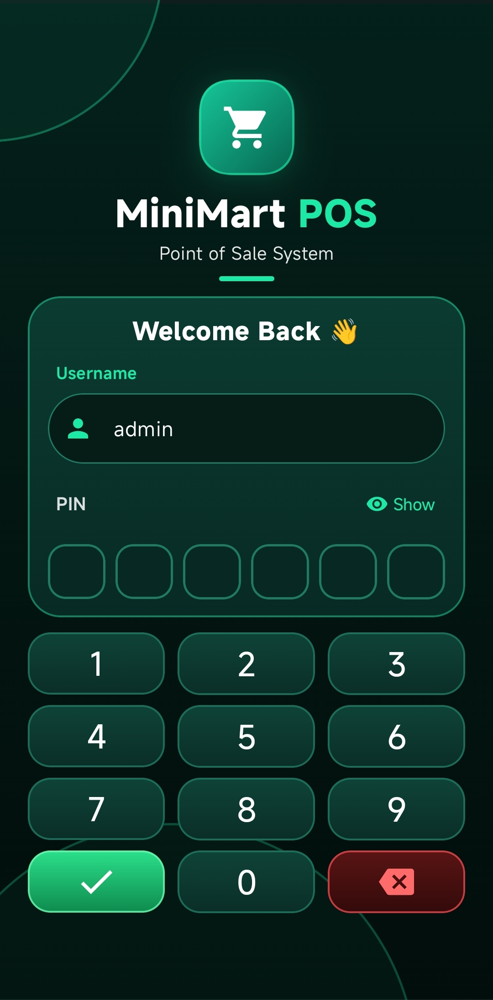
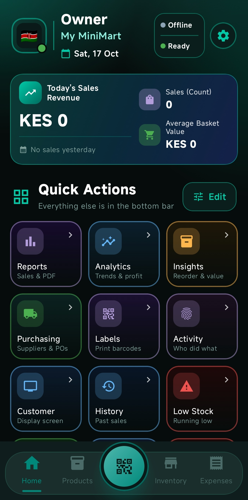
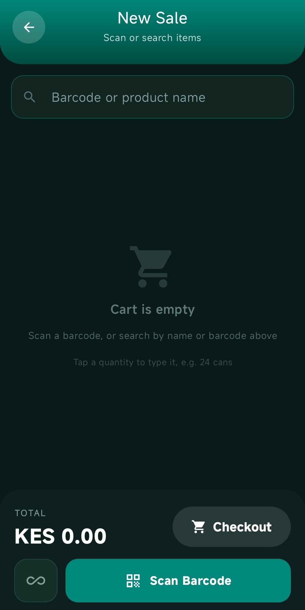
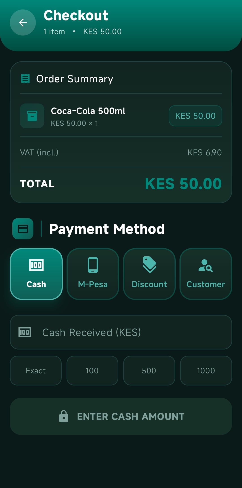
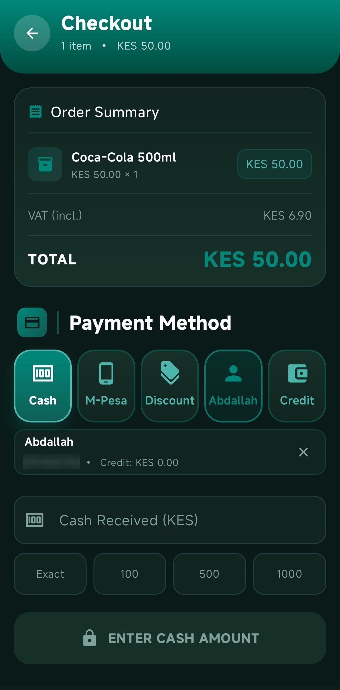
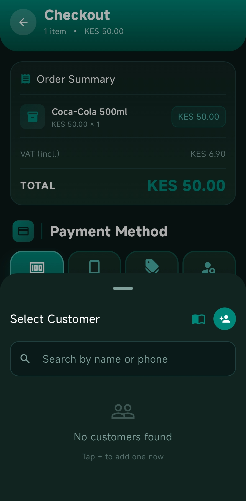

<div align="center">


# 🛒 MiniMart POS

**Fast · Offline · Secure Android Point-of-Sale for Kenyan mini-markets**

Built with Kotlin + Jetpack Compose 🇰🇪

[](https://github.com/Baker0o7/MiniMart-Pos/releases/latest)
[](https://github.com/Baker0o7/MiniMart-Pos/actions)
[](https://developer.android.com)
[](https://kotlinlang.org)
[](https://developer.android.com/jetpack/androidx/releases/room)
[](https://junit.org/junit4/)

</div>

---

## 📱 Screenshots

| Login | Dashboard | New Sale |
|:-----:|:---------:|:--------:|
|  |  |  |

| Checkout | Credit Payment | Customer Search |
|:--------:|:-------------:|:---------------:|
|  |  |  |

---

## ✨ Features

### 🛍️ New Sale
- Camera barcode scanner (ML Kit — EAN-13, UPC, QR, Code-128, Code-39, Data Matrix)
- Bluetooth / USB HID barcode scanner support
- **Weighing scale support (PLU)** — decodes variable-weight EAN-13 barcodes,
  auto-calculates price from weight × price/kg, weight persisted in sale records
  and correctly shown (not "×1") on both the in-app and shareable PDF receipt
- **Continuous scan mode** with animated laser overlay, corner brackets,
  green flash confirmation, and live scan counter badge
- Keyboard "Next" navigation flows through every field in the Add Product form
- Product search by name or barcode with live dropdown — results show stock, and out-of-stock items are flagged
- Cart with quantity stepper, **tap the quantity to type it** (e.g. 24 bottles), per-item discounts
- **Weighed items always ask for the weight** — scanning or tapping a PLU product opens a weight dialog
  with a live price, instead of silently adding one unit
- Inline success / error banner for scans and cart actions
- **Unknown barcode?** Owners and managers are offered "Add product" with the barcode pre-filled; saving puts it straight into the sale
- **Flash toggle** on the camera scanner for dim shops (shown only when the phone has a flash)
- **Inclusive VAT** — tax extracted from price, not added on top
- **Cent-exact totals** — the checkout subtotal/discount/total math runs on an
  internal `Money` value class (Long cents) rather than raw `Double`, avoiding
  the floating-point rounding drift that repeated addition across many cart
  lines can otherwise produce
- **Cart badge** on bottom nav shows pending item count when navigating away
- Guarded against double-tap: rapid double-tapping "Complete Sale" can't create
  two sales from one transaction
- **Atomic sales** — the sale, stock deduction and any customer credit are one
  database transaction; a sale that can't be fully recorded (e.g. not enough
  stock) is rolled back instead of leaving a half-written record
- Confirmation before clearing the cart

### 💳 Checkout & Payments
- **Cash** — one-tap "Exact" plus quick-amount buttons, real change calculation; money fields only accept digits and one decimal point
- **M-Pesa** — ref number field
- **Credit** — customer wallet or buy-on-account (negative balance allowed)
- **M-Pesa STK push (Daraja)** — amounts are rounded up to whole shillings and
  payment status is confirmed by polling; network calls run off the main thread, and the
  sale can't be completed while a prompt is still pending (no double charge)
- **Split payment** — combine credit + cash in one transaction (credit is capped
  at the balance and sale total; change is never counted as till cash), with proper
  error feedback if it fails (shown as an on-screen banner, not silently dropped)
- Customer selector with search + contacts import — debtors (customers who
  owe money) are clearly flagged in red, not shown the same as a zero balance;
  "Save & Select" adds a new customer and selects them in one step (an existing
  phone number reuses that customer instead of creating a duplicate)
- Cash drawer auto-opens on cash payment (configurable)
- Haptic feedback confirms every completed sale
- All money displays respect the app's configurable currency setting
  (no screen is hardcoded to "KES")

### 👤 Customer Credit System
- Register customers with name, phone, email
- **Credit wallet** — deposits, deductions on purchases
- **Buy on account** — negative balance allowed
- Full transaction history per customer
- Deleting a customer asks for confirmation (it also deletes their credit history)
- Refunding or voiding a credit sale automatically returns the credit used
- **Credit Ledger** — all non-zero balances at a glance
  - 🔴 Debtors (negative, owe money) shown first with "OWES [currency] X" in red
  - 🟢 Wallet balances shown in green
  - Two summary stats: "Owed to Shop" + "Wallet Credit"

### 🛡️ Accountability & Recovery
- **Activity log (owner):** every sign-in, sale, discount, void and refund (a written reason is now required), price/cost change, stock adjustment, product add/delete, no-sale drawer opening, shift open/close (with cash variance) and backup is recorded with who did it. Each line is chained to the one before by a hash, so an edited or removed line is detected and the screen says where. Deleting only the newest lines cannot be detected on the phone itself.
- **Start-up and first-open speed (1.16.11):** the release build ships a baseline profile, so the app's own code is compiled ahead of time instead of being interpreted and compiled while you use it. The gain shows after the first launch once Android has processed the profile (a few minutes, or after the phone is idle and charging).
- **Settings clean-up (1.16.12):** the Daraja (STK Push) credentials box is gone from Settings, and the Owner badge and M-Pesa save button follow the accent colour instead of a fixed green.
- **Payment tiles and Daraja (1.16.13):** the Paybill/Till/Agent number box is removed from Settings and the Daraja (M-Pesa STK Push) box is back, and the Checkout payment tiles, heading icon and credit card follow the accent colour.
- **Better barcode scanning (1.16.14):** the camera analyses at 1280x720 instead of 640x480, zooms in by itself on small barcodes, focuses where you tap, and picks the barcode nearest the middle when several are in view. Scanned text is checked in one place (no blanks, control characters or over-long codes), the keyboard/Bluetooth scanner buffer is capped, and the scan overlay follows the accent colour.
- **Settings code split (1.16.15):** no visible change; the Settings screen file was 1,080 lines and is now three smaller ones plus shared form pieces, which makes later changes safer.
- **STK Push completes without typing a code (1.16.16):** Safaricom confirms an STK payment but does not send the receipt number, so the till now records a short generated reference and the sale can finish straight away (type the SMS code over it to link the payment record). Daraja timestamps use Nairobi time, and unused M-Pesa number fields were removed from Settings.
- **No more blank screen from Recents (1.16.17):** if Android had ended the app and you reopened it from Recents, it restored the last screen (for example Settings) while nobody was signed in, which showed an empty page. It now goes to the PIN screen, and a screen you are not allowed to see sends you Home instead of staying blank.
- **Owner-only system settings and lighter background work (1.16.18):** payment (Daraja) credentials, device sync, the cloud link, and backup/restore are now owner-only — checked again at the moment of the action, not just hidden — because a manager could otherwise point STK payments at their own till or restore an old backup to erase sales. A backup is fully integrity-checked before it replaces the live data. Screens stop listening to the database while the app is in the background.
- **Undo for removed cart items (1.16.19):** removing an item from the sale (trash button or reducing it to zero) now shows "Removed … UNDO" for five seconds, and Undo puts it back in the same place. An accidental tap no longer means re-scanning the item.
- **Hold a sale (1.16.20):** on the New Sale screen, "Hold sale" sets the current cart aside so you can serve the next customer, and "Held (n)" lists parked sales to resume or discard. Parked sales are saved, so they survive the app closing; up to 10 are kept. Stock is not reserved, and prices and stock are re-checked when you resume (items no longer available are left out and you are told).
- **Scan button and New Sale layout (1.16.21):** the raised scan button now follows the accent colour (its dark ring was a fixed teal tint) and the cart-count badge is no longer cut off at the edge. On New Sale, Hold and Held (n) moved into the Cart header row next to the item count, freeing a full row for the cart.
- **Whole-app check (1.16.22):** receipt numbers and backup file names now always use plain digits (on phones set to an Arabic or Indian-digit language they could contain other numerals, which breaks matching between tills). The build now runs on a pinned Ubuntu 24.04 image, because GitHub switches its default image on 19 October and an unplanned change could have broken releases.
- **Receipt printing (1.16.23):** receipts now print accented names, "×", bullets and curly quotes correctly on thermal printers (they used to come out as garbage characters), and stray control characters in a product or customer name can no longer be read by the printer as commands.
- **Product form check (1.16.24):** the product form now rejects absurd or non-numeric prices and stock (typing "Infinity" or "NaN" used to be accepted and could break totals and reports).
- **Faster start (1.16.25):** background jobs (low-stock and expiry alerts, backups, sync) are now set up off the launch path, so the app reaches the login screen sooner on slower phones.
- **Security (1.16.26):** new sync pairing codes are now 16 random digits made with a secure generator (the old 6-digit code could be worked out from one captured sync request on shared Wi-Fi, and was not made with a secure generator). Tills already paired keep working with their current code.
- **Add Credit fix (1.16.27):** the 100 / 200 / 500 / 1000 quick-amount buttons in the Add Credit dialog no longer wrap their digits onto separate lines.
- **CI hardening (1.16.28):** the data layer (Room queries, unique barcodes, stock updates, void/refund rules) now has automated tests that run on every push, and lint errors now fail the build instead of being ignored.
- **Theming (1.16.8):** Settings → Appearance now has an accent colour (Teal, Blue, Purple, Orange, Rose) that recolours headers, buttons, the navigation bar, Home and every dark surface at once. Teal is the original look, unchanged. The old Dark Mode switch is gone because it never changed anything (every screen is dark). Menus, dialogs and pickers now use the same dark palette instead of following the phone's light/dark setting and wallpaper colours.
- **Faster Products and Inventory (1.16.7):** the catalogue is loaded into memory when the app starts and kept up to date, so both lists show their rows on the first frame instead of opening empty. The 150 ms wait that every open of these screens used to include is gone (it now applies only while typing in the search box).
- **Main device stays on (1.16.6):** the phone set as the main device now remembers it, and starts the sync server again by itself after the app or phone restarts (and every 15 minutes if Android stopped it). Before, a restart left the tills unable to connect until someone reopened Settings. The server also refuses a connection that sends an endless header.
- **Security (1.16.5):** the main device now signs its sync replies, and a till refuses an unsigned or altered reply, so a device that only answers on the main phone's address cannot feed a till fake prices, stock or customer balances (update both phones together). Sync only connects to private Wi-Fi addresses. Automatic backups are kept in the app's private storage instead of a folder other apps can read on older Android versions (old copies there are deleted after the next good backup). The activity log no longer copies its details into the system log. Known limit: M-Pesa text-message sender names can be faked by a determined fraudster; STK push is the authenticated route.
- **Sync visibility:** Settings → Sync shows when the till last synced and how many sales are waiting. Sales the main device refused are shown in red with a **Retry refused sales** button, so a refused sale can no longer sit unnoticed on one phone.
- **Cloud dashboard management:** the web dashboard has **Manage stores** (remove a store and its cloud data) and **Make a new setup code**. Re-run `cloud/supabase_setup.sql` once to add these (it is safe to run again).
- **M-Pesa verification:** under the code field the till says whether the code is verified (a payment of at least the amount arrived on this phone), short-paid, already used on another sale, not received yet, or badly formed. Turn on **Require a verified code** on the M-Pesa payments screen to refuse unverified M-Pesa sales (STK-push confirmed payments are exempt). The payments list shows which received payments are matched to a sale and which are not.
- **Smart restocking:** an item is due for reorder when stock would run out before a delivery could arrive (3 days) plus a 2-day buffer, based on its recent sales rate. The suggested quantity covers lead time plus 14 days, never less than the product's reorder quantity, with an estimated cost per item and per supplier in the shared list.
- **Batch (FIFO) costing:** each delivery (purchase order, opening stock, stock added) is kept as a cost layer. A sale takes its cost from the oldest layers first, and a void or refund puts the stock back into the same layers. Profit reports use that real cost; stock that predates layers is costed at the product's cost price. Layers are not created retroactively for existing stock.
- **Data check:** Settings → Backup has **Check data**, and the nightly backup runs it too. It looks for sale totals that disagree with their lines, negative stock, customer balances that differ from the credit ledger, one M-Pesa code used on two sales, and damaged cost layers. It only reads; problems are listed and written to the activity log.
- **Roles enforced behind the screens:** voiding/refunding needs manager or owner, editing prices and adjusting stock needs manager or owner, deleting products needs the owner. A refused attempt is written to the activity log.
- **Automatic backups:** about once a day the shop database is copied, opened and checked (integrity check plus required tables); a copy that fails the check is discarded. The newest 7 are kept, manual backups are never deleted, and manual backups are checked too. Owners and managers see a warning on Home when there has been no good backup for 3 days or the last one failed.
- **Hands-free sync:** a paired till syncs every 15 minutes and shortly after each sale or refund, retrying with growing delays when the main device is out of reach. Sales stay queued on the till meanwhile, and sync runs never overlap.

### 🌐 Multi-Device LAN Sync
- No internet, no cloud — pure local WiFi sync
- **Pairing code authentication** — 6-digit code shown on server device,
  required on client device, compared in constant time (not vulnerable to a
  timing side-channel), and **rate-limited** (5 failed attempts locks out
  further guesses for 30s — a 1,000,000-combination code can't be brute-forced
  at LAN speed)
- **Pairing secrets encrypted at rest** — both this device's own code and any
  remembered peer code are stored via Android Keystore-backed
  EncryptedSharedPreferences, not plaintext
- **Real replication, main-device model** — one device is the *main device*
  (acts as server). Each till sends the sales, refunds and voids it made to the
  main device, which validates and applies them (stock, customer credit), then
  the till downloads the main device's products, stock and customer balances.
  Every device ends up with the same stock and balances. Products and prices are
  managed on the main device (a till's own edits are overwritten); sales made
  before a till was paired are not sent.
- **Exactly-once** — each change is applied together with its "received" marker
  in one database transaction, so a retry (dropped connection, double-tapping
  "Sync Now") can't sell the same goods twice. A sale the main device refuses is
  rolled back, reported on the till, and quarantined (not retried forever)
- Requests are signed (HMAC-SHA256 over time, path and body) so the pairing code never crosses the network and a captured request cannot be altered or replayed; both phones need the same app version and a roughly correct clock. Data itself is not encrypted on the LAN: use a Wi-Fi network you trust.
- Server device: toggle "Act as Sync Server", share the displayed code
- Till: enter the main device's IP + pairing code → Sync Now
- **Payment validation** — see Security: every sale is re-checked in the data
  layer, including sales arriving from another till

### 🗃️ Cash Drawer
- ESC/POS kick via thermal printer RJ11 port
- Direct Bluetooth cash drawer support
- Auto-opens on cash payment (toggle) · Test button in Settings

### 📦 Inventory & Products
- **Stock Insights** (Home tile, or **Insights** on the Inventory screen; managers/owners only):
  stock value at cost and retail with potential profit, a **Reorder** list (low or running out within a week,
  with a suggested quantity for ~2 weeks of cover, shareable by supplier as text), **Dead stock** (in stock but
  unsold for 30+ days, with the money tied up), **Fast movers** and stock value by category
- **Inventory screen**: summary tiles (items listed, low stock, stock value at cost), a Low stock filter,
  stock pills, and a stock-adjust dialog that previews the new level, accepts kg for weighed products and
  blocks removing more than you have
- Filter chips by category plus **Low stock**; colour-coded stock pills (in stock / low / out)
- Tap a product to edit it (cashiers get a read-only view); the add/edit form covers price, cost, stock,
  category chips, SKU, unit, VAT %, low-stock threshold, PLU, expiry date picker and a live margin hint
- Supplier info + reorder quantity · Batch number + expiry date
- Color-coded expiry urgency badges · Low-stock background alerts (WorkManager)
- Stock adjustments with reason log
- **PLU / Weighing scale toggle** per product (PLU code + price/kg)
- **Weighed products are stocked in kilograms** — sales deduct the actual weight,
  refunds/voids put it back, and the stock field is entered and shown in kg
- Duplicate barcodes **and duplicate PLU codes** are rejected with a clear message instead of overwriting
  another product; save/adjust errors are shown on screen
- Negative price/stock can't be saved (validated at both the UI and repository layer)

### 🚚 Suppliers & Purchase Orders
- **Purchasing** (Home tile; managers/owners only): suppliers with phone/email/address/notes, tap-to-call, and one-tap import of suppliers already typed into your products.
- **Purchase orders**: draft → sent → partly/fully received, or cancelled. Add items by search, or **Add low stock** (prefers that supplier's own products). Weighed items are ordered in kg.
- **Receive goods** (full or partial): adds to stock and can update each product's cost price. **Close short** finishes a partly delivered order.
- **Supplier payments**: record what you've paid per order; the app shows what you still owe each supplier.
- **Share** an order as text (WhatsApp, SMS, email).

### 🧾 Shift Close, Z-Reports & Drawer
- **Blind close** (on by default; Settings → Shift close & display): the cashier counts the drawer without seeing the expected amount. The over/short figure is shown only to managers and owners.
- **Z-report** at the end of every shift: sales by payment type, discounts, voids, refunds, credit sales, float, counted cash, expected cash and variance, no-sale drawer opens, signature lines. **Print** on the thermal printer or **Share** as text. Past shifts can be reprinted from Shift History.
- **Cash drawer**: kicks on cash sales, **Open drawer (no sale)** on the shift screen (counted on the Z-report), **Open drawer to count** during close, and a selectable kick pin (2 or 5).

### 📺 Customer-Facing Display
- Live cart with big total, discount and a "Thank you / your change" screen after each sale.
- **Customer tile** on Home shows it full-screen on this device; or enable **second screen** in Settings to mirror it on an attached HDMI / dual-screen POS display.

### 🏷️ Barcode Label Printing
- **Labels** tile (managers/owners): search products, pick copies, optionally print the price, or add all low-stock items. Prints EAN-13 or Code 128 labels on the connected thermal printer.

### 🏠 Home & Settings
- Home shows the signed-in user's initial and today's date, a real vs-yesterday trend (hidden when there was
  no sale yesterday), and low-stock / expiry alerts right under the stats
- Settings sections collapse (with a one-line status when closed), save buttons confirm with "✓ Saved" and only
  enable when something changed, M-Pesa numbers accept digits only, and backups list their date and size

### 📲 M-Pesa Payment Tracking (SMS)
- Optional, off by default: a manager turns it on in the **M-Pesa** tile on Home and grants SMS permission
- Reads incoming M-Pesa confirmations (personal, Till and Paybill wording) and logs sender name, phone, amount,
  transaction code and time; a repeated text is stored once (unique code)
- Today / week / month / year totals and a payment list per period
- **Verify a payment**: type the code from a customer's message — it is confirmed only if this phone received it
  from the MPESA sender ID. Texts from ordinary numbers (forwarded or typed fakes) are ignored
- This is a separate payments ledger; it does not create sales, so it never double-counts a sale rung up at the till

### ☁️ Multi-Store Cloud Dashboard
See every store in one web page: sales totals and 30-day trend, low-stock and expiry alerts, estimated profit and expenses, and shift / Z-report status (with cash variance). Uses **your own free Supabase project**; nothing goes through anyone else's server.

1. Create a project at supabase.com. Open **SQL Editor**, paste `cloud/supabase_setup.sql`, **first change the setup code and the owner email near the top**, and run it.
2. **Authentication → Users → Add user** (the same owner email you put in the script, plus a password), then turn **off** "Allow new users to sign up". Only that email can read the data, even if sign-ups stay on. Already set up? Run the new script and then `update app_config set value = 'you@example.com' where key = 'owner_email';`.
3. In each store's app (admin): **Settings → Cloud dashboard** → enter Project URL, anon key (Project Settings → API) and the setup code → **Connect & upload**. The app then uploads every few hours and when a shift is closed.
4. Open `cloud/dashboard/index.html` (double-click it, or host it on GitHub Pages / any static host), enter the URL and anon key, and sign in.

Re-installing the app or tapping Disconnect registers the phone as a new store; delete the old one in Supabase (Table Editor → `stores`) so it disappears from the dashboard. Renaming the shop updates its name on the next upload.

Security: the anon key alone can neither read data nor write to an existing store; each phone has its own random secret (only a hash is stored online) and only the signed-in owner can read. Customer names, phone numbers and receipts are not uploaded. Profit is only accurate for products that have a cost price (the dashboard shows the coverage).

### 📊 Reports & Analytics
- **Analytics dashboard** (Home tile; managers/owners): 7 / 30 / 90-day view with revenue (and change vs the
  previous period), sales count, average basket, gross and net profit (it warns when too few products have a
  cost price for profit to be trusted), daily/weekly revenue chart, payment-method mix, busiest hours,
  best weekdays, top products and sales by category
- Revenue vs yesterday (real % comparison, flips red when down)
- Dashboard auto-refreshes at midnight — "today" always means today
- Transaction count, average basket, top-selling items
- **Custom date range** — the "Custom" chip in Reports and Expenses opens a date-range picker
- **Reports & Expenses** use proper calendar week (Mon–Sun) and calendar month,
  not rolling 7/30-day windows
- **Expenses** are grouped by day (Today / Yesterday / date) with daily totals, show each category's share
  of spend on the P&L tab, and can be logged for today or yesterday; the signed-in user is recorded on each one
- Sales History: color-coded payment method chips (💵 Cash / 📱 M-Pesa / 🤝 Credit / 🔀 Split)
- **Share a business report as a PDF via WhatsApp** — the green share button on Reports builds an A4 report
  for the selected period (today / week / month / custom range): revenue, sales count, average basket,
  discounts, VAT, refunds/voids, sales by payment method, top sellers, expenses by category and net (sales − expenses),
  and opens WhatsApp with the PDF attached (falls back to the share sheet if WhatsApp isn't installed) — ideal for
  end-of-day reports to an accountant or partner
- **Quick Void** on COMPLETED sales from the history list (Manager+)
- **Refund / Void** from the receipt screen is limited to Owner and Manager; each
  can only be applied once, restores stock and returns any credit used

### 👥 Role-Based Access Control

| Permission | Owner | Manager | Cashier |
|---|:---:|:---:|:---:|
| Process sales | ✅ | ✅ | ✅ |
| Apply discounts | ✅ | ✅ | ❌ |
| View reports | ✅ | ✅ | ❌ |
| Edit products | ✅ | ✅ | ❌ |
| Void sales | ✅ | ✅ | ❌ |
| Multi-device sync | ✅ | ✅ | ❌ |
| User management | ✅ | ❌ | ❌ |

Every route above is enforced by a route-level `AccessGuard` that bounces
unauthorized users, even on direct navigation. Cannot remove the last active
Owner account (permanent lockout protection).

### 🔐 Security
- **Payments validated below the UI** — before a sale is saved (and when one
  syncs in from another till) the data layer re-checks that line totals match
  price × quantity, the total matches the lines and discounts, the cash or
  M-Pesa amount covers the bill, change is right, credit and split sales have a
  customer, and an M-Pesa reference is well formed, not already used by a live
  sale, and (when the SMS tracker saw that payment) was for at least the amount due
- **PIN required after the app restarts** — a signed-in session no longer survives the app being killed or the
  phone rebooting; removed accounts lose their session immediately
- **Escalating PIN lockout** — after 3 wrong PINs the lock lasts 30s, then 1m, 2m, 4m … up to 15 min, and resets
  on a correct PIN (persisted, so force-closing doesn't reset it)
- **User management is enforced in code, not just hidden** — only an Owner can add or remove users or reset
  another user's PIN, and new PINs must be 4–12 digits and not `1234`
- **Argon2id PIN hashing** (t=3, m=64MB, p=4), auto-upgrades legacy SHA-256 on
  login, constant-time comparison on both paths; hashing runs off the main thread
  and new users always get Argon2id
- **Default PIN must be changed** — signing in with the factory `1234` PIN shows a
  non-dismissable "Set a new PIN" dialog
- **Biometric login** — bound to one explicitly opted-in user per device
  (Settings → Account). Any fingerprint on the device cannot authenticate as
  an arbitrary username.
- **Persisted 3-strike lockout** — survives force-close, task-kill, and device
  reboot
- **15-minute inactivity auto-logout** — any touch or scanner key resets the timer, and the
  timeout returns to the PIN screen (it used to sign out in state only)
- **Persistent, thread-safe audit log** at `files/audit.log` covering logins,
  logouts, biometric sign-ins, completed sales, discounts, credit usage, and user
  creation / removal / PIN resets
- **Sync pairing secrets** — rate-limited, constant-time compared, and
  encrypted at rest (see Multi-Device Sync above)
- **At-rest database protection**: relies on Android's File-Based Encryption
  (FBE), hardware-backed and enabled by default since Android 7.0. App-level
  SQLCipher encryption was evaluated twice and reverted both times due to
  native-library crashes on startup; FBE was judged the safer,
  zero-maintenance choice for this app.

### 💾 Backup & Data
- One-tap backup to the app's own storage (`Android/data/com.minimart.pos/files/backups/`) —
  no all-files permission required. Use **Share Latest Backup** to copy it off the
  device (app storage is cleared on uninstall). Older backups in
  `Downloads/MiniMartPOS/backups/` still appear in the restore list
- **Optional passphrase encryption** — set a passphrase when backing up and the file is saved as an
  encrypted `.mmbak` (AES-256-GCM, PBKDF2 key), unreadable without it, so it's safe to share or upload;
  it restores on any phone. Wrong passphrases and tampered files are rejected. (A lost passphrase can't be recovered.)
- Restores are validated first (SQLite header, schema version) and a safety copy of the
  current data is kept
- **Restore requires explicit two-step confirmation** — selecting a backup
  shows exactly what will be lost before anything is overwritten, then the
  app automatically restarts (WAL/SHM files handled correctly)
- 100% offline — Room SQLite v13, no internet required for core operation

### 🎨 UI / UX
- Deep dark teal theme — readable in bright retail lighting; status-bar and navigation icons
  stay light whichever Dark-mode setting is chosen
- Low-stock and expiry alerts ask for notification permission (Android 13+) and open Inventory when tapped,
  after sign-in, without discarding an open cart
- Dashboard header shows the signed-in role (Owner / Manager / Cashier) and store name
- Emerald "glass" login screen with a 6-box PIN field, large keypad and haptic key presses
- System-bar insets handled once, so nothing hides behind the navigation bar
- Consistent gradient top bar across all screens
- Press-scale animation on dashboard action cards
- Color-coded payment method chips throughout
- Consistent destructive-action dialogs app-wide (styled red confirm +
  bordered cancel, clear "cannot be undone" copy)
- Animated scanner overlay: pulsing border, sweeping laser, corner brackets
- Pull-to-refresh on dashboard (updates today + yesterday revenue)

---

## 🧪 Testing

Local JVM unit tests (`app/src/test`) cover the core financial calculation
logic — no emulator needed:

```bash
./gradlew test
```

| Test file | Covers |
|---|---|
| `MoneyTest` | Cent-exact arithmetic, the classic `0.1 + 0.2 != 0.3` Double failure case, rounding, clamping |
| `CartUiStateTest` | Checkout subtotal/discount/total math, the discount-floor regression, weighed-item pricing |
| `CartDiscountTest` | Discount capping: oversized/stale/negative global and line discounts never give goods away |
| `PluDecoderTest` | Weighing-scale barcode decode/reject cases, price calculation |

---

## 🏗️ Tech Stack

| Layer | Technology |
|---|---|
| Language | Kotlin 2.0 |
| UI | Jetpack Compose + Material 3 |
| Architecture | MVVM · Clean Architecture · Repository |
| DI | Hilt |
| Database | Room 2.6 (SQLite v13), Android FBE at rest |
| Money | Custom `Money` value class (Long cents) for checkout-critical math |
| PIN Security | Argon2id (argon2-kt 1.4.0) |
| Sensitive Storage | Jetpack Security (`EncryptedSharedPreferences`, Keystore-backed) |
| Camera | CameraX + ML Kit Barcode |
| Sync | Custom HTTP server/client over LAN WiFi, pairing-code authenticated |
| Background | WorkManager (low-stock + expiry alerts) |
| Preferences | DataStore + SharedPreferences |
| Printing | Bluetooth ESC/POS |
| Navigation | Navigation Compose |
| State | `SavedStateHandle` for process-death recovery |
| Paging | Paging 3 (Sales History loads 30 rows at a time, totals computed in SQL) |
| Architecture layers | ViewModel → use case (`domain/usecase`) → repository → DAO |
| Testing | JUnit4 (local unit tests) · GitHub Actions runs them on every push/PR and gates releases |

---

## 🚀 Getting Started

```bash
git clone https://github.com/Baker0o7/MiniMart-Pos.git
cd MiniMart-Pos
./gradlew assembleDebug
```

**First-launch credentials**

| Field | Value |
|---|---|
| Username | `admin` |
| PIN | `1234` (you'll be asked to change it on first sign-in) |

---

## 📁 Project Structure

Gradle modules: **`:app`** (UI, DI wiring, sync, printer, M-Pesa) · **`:data`** (Room database,
DAOs, entities, repositories) · **`:core`** (Money, PluDecoder, PinHasher, UiResult).

```
data/src/main/kotlin/com/minimart/pos/                 ← :data module
├── data/
│   ├── dao/          ProductDao · SaleDao · UserDao · ExpenseDao
│   │                 ShiftDao · CustomerDao · SyncDao
│   ├── db/           AppDatabase (v13) · DatabaseCallback (seed)
│   │                 AppMigrations (v8→…→v13)
│   ├── entity/       Product · Sale · SaleItem · User · Expense
│   │                 Shift · Customer · CreditTransaction · SyncLog
│   └── repository/   (one per entity + SettingsRepository)

core/src/main/kotlin/com/minimart/pos/                 ← :core module
├── util/             Money · PluDecoder · PinHasher · UiResult
└── di/               SecurePrefs qualifier

app/src/main/kotlin/com/minimart/pos/                  ← :app module
├── di/               DatabaseModule
├── domain/usecase/   CompleteSaleUseCase · RefundSaleUseCase · VoidSaleUseCase
├── printer/          ThermalPrinter · CashDrawerManager
├── scanner/          MLKitScanner · KeyboardScanner · BluetoothScannerManager
├── sync/             SyncServer · SyncClient
├── ui/
│   ├── screen/       17 screens (Login → CreditOverview) + shared DateRangeDialog
│   ├── viewmodel/    Per-screen ViewModels + SessionViewModel · SyncViewModel
│   ├── theme/        DT color tokens
│   └── NavGraph.kt   Routes + BottomNavBar (cart badge) + AccessGuard
├── util/             BackupManager · PdfReceiptGenerator · RoleManager
│                     SessionManager · AuditLogger · Extensions
└── worker/           LowStockWorker · ExpiryAlertWorker

app/src/test/kotlin/com/minimart/pos/
├── util/             MoneyTest · PluDecoderTest
└── ui/viewmodel/     CartUiStateTest
```

---

## 🚢 Releases

Releases are built by the **Build & Release** GitHub Actions workflow (run it from the
Actions tab, or push a `v*` tag). The version comes from `versionName` in
`app/build.gradle.kts`; the workflow publishes a signed APK and AAB to GitHub Releases.

---

## ⚙️ CI/CD Signing Secrets

```
SIGNING_KEY_ALIAS      = minimart
SIGNING_KEY_PASSWORD   = android
SIGNING_STORE_PASSWORD = android
```

---

<div align="center">

Built with ❤️ for Kenyan mini-markets 🇰🇪

[](https://github.com/Baker0o7/MiniMart-Pos/releases/latest)

</div>
